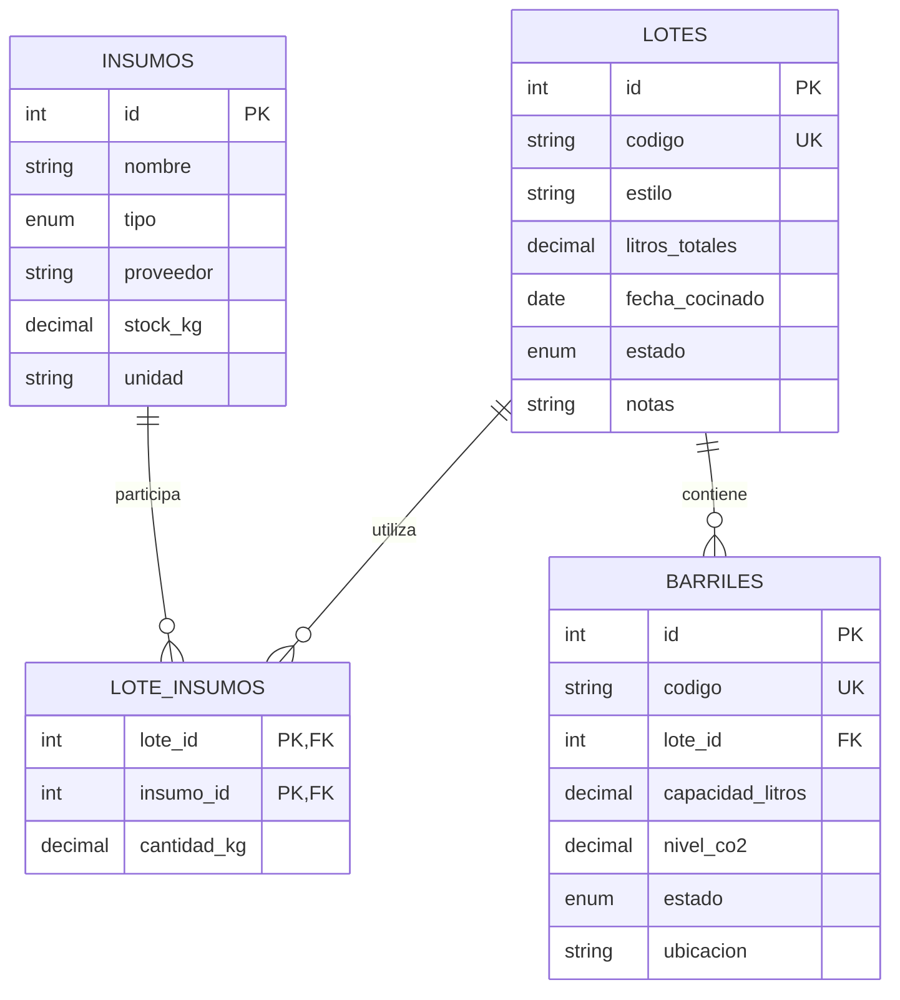

# Modelo entidad-relación

## Relaciones

- Un lote puede dividirse en muchos barriles (1:N).
- Un lote puede utilizar muchos insumos y un insumo puede participar en muchos lotes (N:M), resuelto con `lote_insumos`.
- `lote_insumos` deja preparada la trazabilidad de cantidades utilizadas para una siguiente iteración del CRUD.
