# Mini Proyecto 1 · BrewMaster
## Modelado de datos empresariales e inicio del CRUD

**Estudiante:** Alex Aguilar López  
**Curso:** Desarrollo Web Full Stack  
**Docente:** Barry  
**Fecha:** 05-11-2026

## 1. Tema elegido y justificación empresarial

BrewMaster es un sistema empresarial para una microcervecería artesanal. Su objetivo es controlar los insumos utilizados en la producción, los lotes de cerveza cocinados y los barriles que se encuentran en fermentación o maduración.

El sistema resuelve una necesidad real: permite mantener la trazabilidad de cada producción, conocer el inventario disponible, identificar qué lotes están activos y consultar dónde se encuentra cada barril. Esto reduce errores de registro y facilita la operación diaria de la empresa.

El sistema no implementa autenticación, usuarios ni roles, ya que el alcance del proyecto se concentra en los CRUDs.

## 2. Entidades y relaciones

- **Insumos:** nombre, tipo, proveedor, stock en kilogramos y unidad.
- **Lotes:** código, estilo, litros producidos, fecha de cocinado, estado y notas.
- **Barriles:** código, lote asociado, capacidad, nivel de CO₂, estado y ubicación.
- **LoteInsumos:** tabla intermedia para registrar los insumos utilizados en cada lote.

Relaciones principales:

- Un lote puede contener muchos barriles: relación 1:N.
- Un lote puede utilizar muchos insumos y un insumo puede utilizarse en muchos lotes: relación N:M resuelta con `lote_insumos`.

## 3. Diagrama entidad-relación

Consulta el diagrama completo en [02-modelo-datos.md](./02-modelo-datos.md).

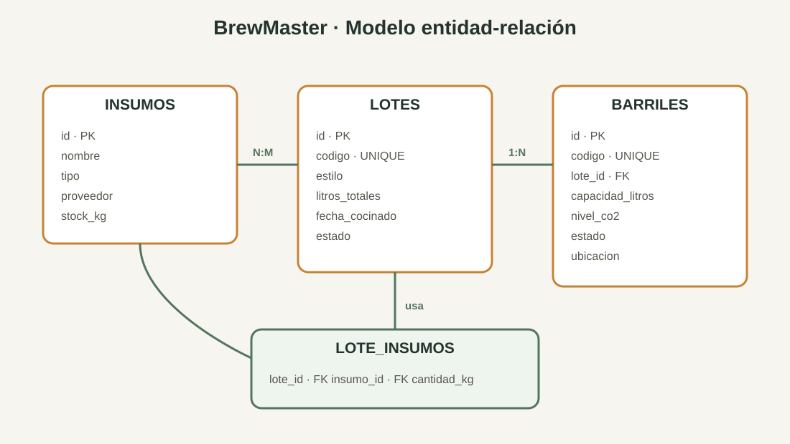

## 4. Evidencia del frontend React

### 4.1 Gestión de insumos

La pantalla muestra el dashboard, las métricas y la tabla con tres insumos registrados.

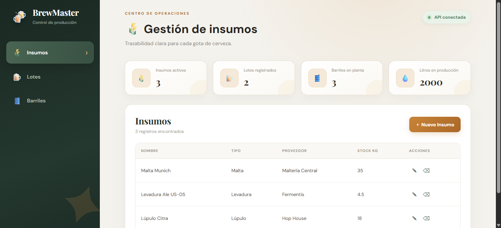

### 4.2 Formulario de creación

El formulario permite registrar un nuevo insumo desde la interfaz React.

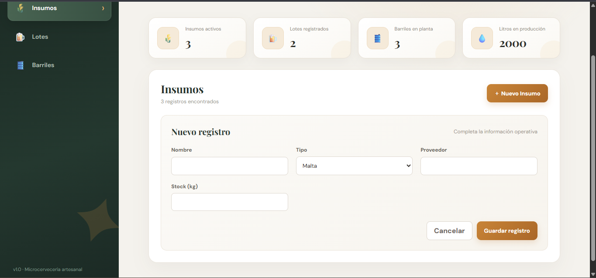

### 4.3 Gestión de lotes

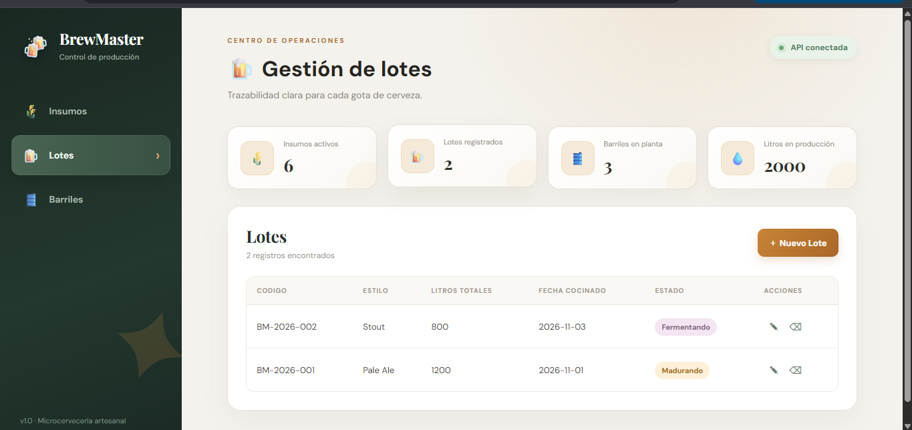

### 4.4 Gestión de barriles

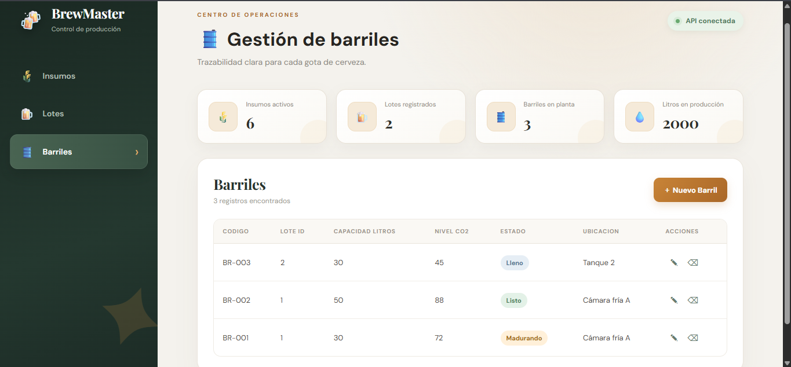

## 5. Evidencia de la API REST en Postman

### 5.1 Health check

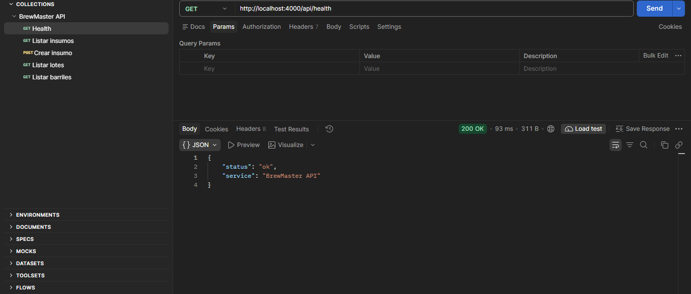

La API responde `200 OK` y confirma que el servicio está activo.

### 5.2 Listar insumos

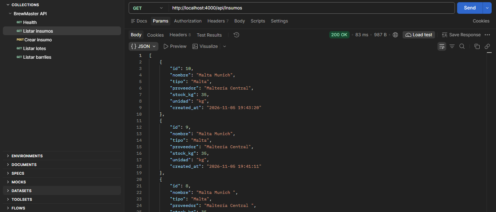

La API devuelve un arreglo JSON con código `200 OK`.

### 5.3 Crear un insumo

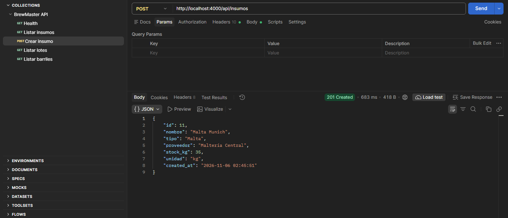

La API crea el registro y responde con código `201 Created`.

### 5.4 Listar lotes y barriles

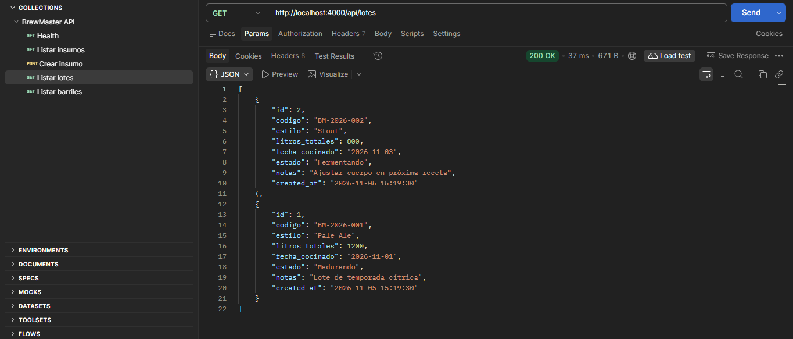

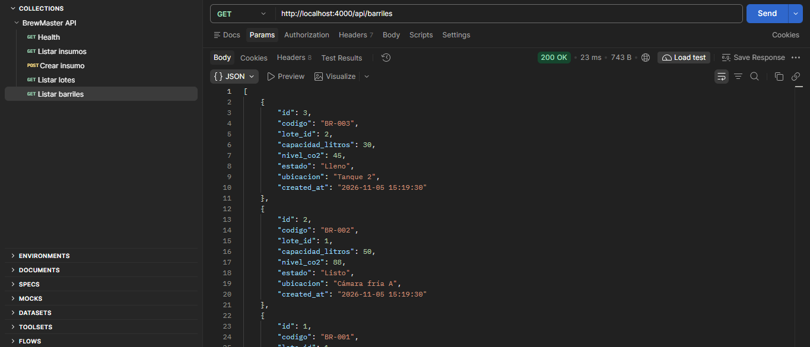

### 5.5 Validación del backend

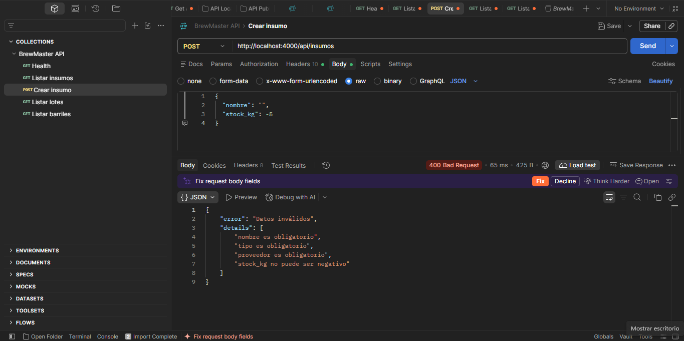

Al enviar datos incompletos o inválidos, la API responde `400 Bad Request` y detalla los errores encontrados.

## 6. Estructura del proyecto

```text
BrewMaster/
├── backend/
│   ├── data/
│   └── src/
├── frontend/
│   ├── src/
│   └── package.json
├── docs/
├── postman/
├── package.json
└── README.md
```

## 7. Tecnologías utilizadas

- Node.js
- Express
- SQLite mediante `sql.js`
- React
- Vite
- Postman

## 8. Validación final

El proyecto fue validado con:

```text
npm run test:api
npm run build
```

Resultado de las pruebas:

```text
API tests OK: listar, crear, validar y eliminar
```

El frontend genera correctamente el build de producción con Vite.

## 9. Conclusión

BrewMaster cumple con los objetivos del Día 1: presenta una idea empresarial justificada, un modelo de datos con relaciones, una estructura separada de backend y frontend, una API REST funcional, persistencia SQLite, validaciones y el inicio del CRUD para las entidades principales.
